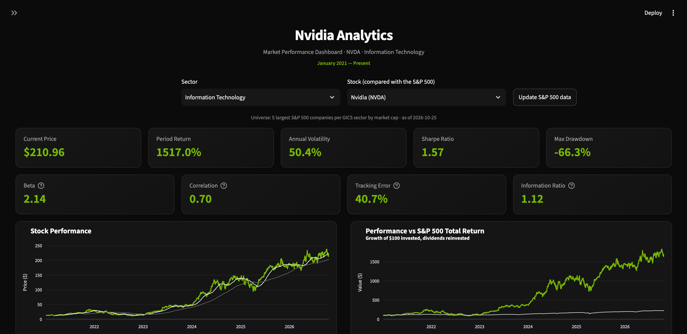

# Leaders sectoriels du S&P 500 — Tableau de bord risque et performance actions

[](https://sp500-sector-leaders.streamlit.app)
[](https://github.com/nassimgnl/sp500-sector-leaders-dashboard/actions/workflows/tests.yml)
[](https://github.com/nassimgnl/sp500-sector-leaders-dashboard/actions/workflows/update-universe.yml)

**▶ [Ouvrir le tableau de bord en ligne](https://sp500-sector-leaders.streamlit.app)** : aucune installation nécessaire.

Un tableau de bord interactif pour analyser le profil rendement/risque des plus grandes entreprises américaines de chaque secteur GICS, comparées à l'indice S&P 500 Total Return.

Développé en Python avec pandas, Plotly et Streamlit, à partir de données de marché publiques.

**Auteur :** Nassim Goundoul



---

## Pourquoi ce projet

Lorsqu'un gérant de portefeuille ou un sélectionneur de fonds étudie une action, les premières questions sont toujours les mêmes :

- Quelle a été sa performance sur la période, et **quel risque a-t-il fallu prendre** pour l'obtenir ?
- Quelle a été la **pire perte du plus haut au plus bas** qu'un investisseur a réellement dû encaisser ?
- A-t-elle **surperformé son indice de référence** à base comparable (dividendes inclus) ?
- Comment les rendements se sont-ils **répartis dans le temps** : une capitalisation régulière ou quelques mois extrêmes ?

Ce tableau de bord répond à ces questions sur un seul écran pour les leaders de chaque secteur du S&P 500, afin de comparer les entreprises selon une méthodologie cohérente et reproductible.

## Fonctionnalités

- **Sélection des actions par secteur** : choix de l'un des 11 secteurs GICS, puis de l'une de ses plus grandes entreprises (classées par capitalisation boursière).
- **Indicateurs clés de rendement et de risque** : performance totale sur la période, volatilité annualisée, ratio de Sharpe et perte maximale (maximum drawdown).
- **Indicateurs relatifs à l'indice de référence**, tels qu'utilisés en sélection de fonds : bêta, corrélation, tracking error et ratio d'information par rapport au S&P 500 Total Return.
- **Graphique des cours** avec moyennes mobiles à 50 et 200 jours en option.
- **Comparaison avec l'indice** : évolution de 100 $ investis dans l'action et dans le S&P 500 Total Return, dividendes réinvestis des deux côtés.
- Graphiques des **rendements mensuels**, de la **distribution des rendements quotidiens** et des **drawdowns**.
- **Période d'analyse ajustable** (dates de début et de fin dans la barre latérale).
- **Mise à jour de l'univers en un clic** : le bouton *Update S&P 500 data* recalcule le top 5 de chaque secteur à partir de la composition et des capitalisations les plus récentes de l'indice, et ne met à jour la liste des actions que si elle a réellement changé.

## Univers d'investissement

L'univers sélectionnable est composé des **cinq plus grandes valeurs du S&P 500 par capitalisation boursière dans chacun des 11 secteurs GICS**, soit 55 entreprises. Aucune valeur n'est ajoutée manuellement.

Règles de construction (`universe_refresh.py`) :

1. Télécharger la liste actuelle des composants du S&P 500 avec le secteur GICS de chaque entreprise.
2. Récupérer la capitalisation boursière de chaque composant.
3. Conserver **une seule catégorie d'actions par entreprise** (par ex. GOOGL mais pas GOOG) afin qu'une entreprise n'occupe jamais deux places dans son secteur.
4. Classer les entreprises de chaque secteur par capitalisation boursière et garder les cinq premières.
5. Enregistrer le résultat, avec sa date de construction, dans `data/universe.csv`.

<!-- universe:start -->
Univers au **25 octobre 2026** (trié par capitalisation boursière au sein de chaque secteur) :

| Secteur GICS | Entreprises |
|---|---|
| Communication Services | GOOGL, META, NFLX, DIS, VZ |
| Consumer Discretionary | AMZN, TSLA, HD, MCD, TJX |
| Consumer Staples | WMT, COST, KO, PG, PM |
| Energy | XOM, CVX, COP, MPC, VLO |
| Financials | BRK-B, JPM, V, MA, BAC |
| Health Care | LLY, JNJ, ABBV, UNH, MRK |
| Industrials | CAT, GE, RTX, GEV, DE |
| Information Technology | NVDA, AAPL, MSFT, AVGO, MU |
| Materials | LIN, NEM, FCX, SHW, ECL |
| Real Estate | WELL, PLD, EQIX, AMT, SPG |
| Utilities | NEE, SO, DUK, CEG, AEP |
<!-- universe:end -->

Stocker l'univers dans un fichier versionné, plutôt que de le recalculer à chaque chargement de page, garde le tableau de bord rapide et rend la liste des actions **reproductible et datée**.

### Mettre à jour l'univers

Cliquer sur **Update S&P 500 data** dans le tableau de bord (ou lancer `python scripts/build_universe.py`). L'univers est reconstruit à partir des données les plus récentes puis comparé à l'univers actuel :

- **Composition inchangée** : si les mêmes entreprises figurent dans les mêmes secteurs, le fichier n'est pas modifié et conserve sa date d'origine, même si les capitalisations ou le classement au sein du top 5 ont bougé.
- **Composition modifiée** : si une entreprise est entrée dans le top 5 d'un secteur ou en est sortie, ou a été reclassée dans un autre secteur, le nouvel univers est enregistré à la date du jour et le tableau de bord liste les entreprises ajoutées et retirées.
- **Échec du téléchargement** : si une source est inaccessible ou renvoie des données inattendues, rien n'est écrit et l'univers actuel reste utilisé.
- **Hébergement en lecture seule** : si le nouvel univers ne peut pas être enregistré sur le serveur, il est tout de même appliqué à la session du visiteur, de sorte que la mise à jour est toujours visible.

Le fichier est écrit de manière atomique (fichier temporaire, puis renommage) : une mise à jour interrompue ne peut donc jamais laisser un univers à moitié écrit.

### Mise à jour quotidienne automatique

Un workflow GitHub Actions planifié ([`update-universe.yml`](.github/workflows/update-universe.yml)) exécute la même mise à jour après chaque séance de bourse américaine. Lorsque la composition a changé, il commite le nouveau `data/universe.csv` et régénère le tableau de l'univers de ce README ; le tableau de bord en ligne se redéploie alors automatiquement depuis le dépôt. Aucune machine locale n'intervient.

## Sources de données

| Donnée | Source | Remarques |
|---|---|---|
| Composition du S&P 500, secteur GICS, CIK | [Wikipedia : List of S&P 500 companies](https://en.wikipedia.org/wiki/List_of_S%26P_500_companies) | Copie publique de la liste des composants publiée par S&P Dow Jones Indices |
| Capitalisation boursière | Yahoo Finance, via [`yfinance`](https://github.com/ranaroussi/yfinance) | Utilisée uniquement pour classer les entreprises lors de la construction de l'univers |
| Cours quotidiens des actions | Yahoo Finance, via `yfinance` | Cours de clôture **ajustés des divisions d'actions et des dividendes** (`auto_adjust=True`) |
| Indice de référence | Yahoo Finance : indice S&P 500 Total Return (`^SP500TR`) | Dividendes réinvestis, cohérent avec les cours ajustés des actions |

Le choix de la version **dividendes réinvestis** (total return) de l'indice est délibéré : comparer des cours ajustés des dividendes au S&P 500 hors dividendes (`^GSPC`) surestimerait la performance relative de l'action. Depuis janvier 2021, l'écart entre les deux indices est d'environ 18 points de pourcentage.

Les cours sont mis en cache pendant une heure dans l'application pour limiter les appels au fournisseur de données.

## Méthodologie

Tous les indicateurs sont calculés à partir des cours de clôture ajustés quotidiens $P_t$ sur la période sélectionnée, en supposant 252 jours de bourse par an. Les indicateurs relatifs à l'indice n'utilisent que les dates pour lesquelles l'action et l'indice ont tous deux un rendement (`metrics.py`).

| Indicateur | Définition |
|---|---|
| Rendement quotidien | $r_t = P_t / P_{t-1} - 1$ |
| Performance sur la période | $P_T / P_0 - 1$ (performance totale, les cours incluant les dividendes) |
| Rendement annualisé | $(1 + \bar{r})^{252} - 1$, où $\bar{r}$ est le rendement quotidien moyen |
| Volatilité annualisée | $\sigma(r_t) \times \sqrt{252}$ |
| Ratio de Sharpe | (rendement annualisé − 4 %) / volatilité annualisée, avec un taux sans risque constant de 4 % |
| Perte maximale (maximum drawdown) | $\min_t \left( P_t / \max_{s \le t} P_s - 1 \right)$ |
| Bêta | $\mathrm{Cov}(r^{s}, r^{b}) / \mathrm{Var}(r^{b})$, où $r^{s}$ et $r^{b}$ sont les rendements quotidiens de l'action et de l'indice |
| Corrélation | Corrélation de Pearson entre $r^{s}$ et $r^{b}$ |
| Tracking error | $\sigma(r^{s} - r^{b}) \times \sqrt{252}$ |
| Ratio d'information | $252 \times \overline{(r^{s} - r^{b})}$ / tracking error |
| Moyennes mobiles | Moyennes simples à 50 et 200 jours du cours de clôture ajusté |
| Rendements mensuels | Variation du cours de clôture ajusté d'une fin de mois à la suivante |
| Évolution de 100 $ | $100 \times P_t / P_0$ pour l'action comme pour l'indice |

## Limites

Il s'agit de simplifications connues, acceptables pour un outil exploratoire et listées ici explicitement :

- **Biais d'anticipation et biais du survivant** : l'univers est sélectionné à partir des capitalisations *actuelles* et appliqué à des périodes passées. Les leaders sectoriels d'aujourd'hui sont, par construction, des entreprises qui ont bien performé : les résultats historiques de cet univers sont donc flatteurs.
- **Taux sans risque constant** : le ratio de Sharpe utilise un taux fixe de 4 % au lieu du taux réel des bons du Trésor sur la période.
- **Annualisation** : le rendement annualisé capitalise la moyenne arithmétique des rendements quotidiens, ce qui est supérieur au TCAC (CAGR) réellement obtenu pour les actions volatiles.
- **Indice de référence unique** : chaque action est comparée au S&P 500 dans son ensemble plutôt qu'à son propre indice sectoriel.
- **Fournisseur de données** : Yahoo Finance est une source gratuite et non officielle, inadaptée à un usage en production.

## Feuille de route

- Indicateurs de sélection de fonds supplémentaires : **alpha de Jensen**, **ratios de capture à la hausse et à la baisse**, batting average.
- **Indices sectoriels** (par ex. les ETF sectoriels SPDR) en plus du S&P 500.
- **Taux sans risque variable dans le temps** (bons du Trésor à 13 semaines, `^IRX`) pour le ratio de Sharpe, et un **ratio de Sortino**.
- Volatilité, Sharpe et corrélation sur **fenêtres glissantes**.
- Comparaison côte à côte de plusieurs actions.
- **Univers point-in-time** pour supprimer le biais d'anticipation dans l'analyse historique.

## Structure du projet

```
.
├── app.py                    # Tableau de bord Streamlit
├── metrics.py                # Indicateurs relatifs à l'indice (bêta, tracking error, ...)
├── stock_universe.py         # Règles de sélection et validation de l'univers
├── universe_refresh.py       # Reconstruction en direct de l'univers, enregistrée seulement si elle a changé
├── scripts/
│   └── build_universe.py     # Mise à jour de l'univers en ligne de commande (utilisée aussi par le workflow planifié)
├── .github/workflows/       # Tests CI et mise à jour quotidienne de l'univers
├── data/
│   └── universe.csv          # Univers d'actions daté utilisé par le tableau de bord
├── tests/                    # Tests unitaires (règles de l'univers) et tests de l'application (Streamlit AppTest)
├── docs/
│   └── dashboard.png
├── .streamlit/config.toml    # Thème sombre
├── requirements.txt
└── requirements-dev.txt
```

## Démarrage

Nécessite Python 3.11 ou plus récent.

```bash
git clone https://github.com/nassimgnl/sp500-sector-leaders-dashboard.git
cd sp500-sector-leaders-dashboard

python3 -m venv .venv
source .venv/bin/activate
pip install -r requirements.txt

streamlit run app.py
```

Le tableau de bord s'ouvre à l'adresse http://localhost:8501.

Pour actualiser l'univers d'actions avec les capitalisations boursières actuelles :

```bash
python scripts/build_universe.py
```

## Tests

```bash
pip install -r requirements-dev.txt
pytest
```

La suite de tests couvre les indicateurs relatifs à l'indice (vérifiés sur des séries de rendements synthétiques dont le résultat est connu), les règles de sélection de l'univers (classement des N premiers, dédoublonnage des catégories d'actions, validation des entrées), la logique de mise à jour (fichier réécrit uniquement si la composition change, intact en cas d'échec), l'intégrité du fichier d'univers fourni, et le tableau de bord lui-même (vue par défaut, sélection du secteur et de l'action, utilisation du S&P 500 Total Return comme indice de référence, bouton de mise à jour) via `AppTest` de Streamlit. Les tests de l'application téléchargent des données de marché en direct et nécessitent donc une connexion internet.

## Avertissement

Ce projet est réalisé à des fins pédagogiques et de démonstration uniquement. Il ne constitue ni un conseil en investissement ni une recommandation d'achat ou de vente d'un quelconque titre.
